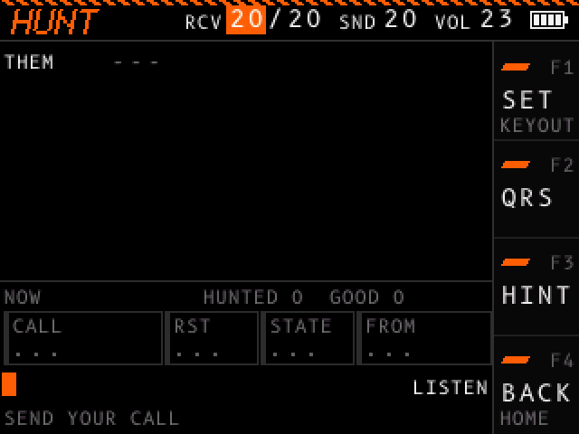

# Hunt

On this screen you are the hunter. An activator calls CQ from a park (POTA) or a summit (SOTA), you work the activator, and then you log the QSO. About two activators in three are on a park. An activator on a summit signs with `/P` after the callsign.

Open ON AIR in the [menu](menu.md), then HUNT. The header shows HUNT and the RCV, SND and VOL values. Set your callsign first in the CALLSIGN section of the [settings](settings.md#callsign).

## Work a QSO

Your over ends one word gap after a last word of `K`, `BK` or `KN`, or when you stop keying for three word gaps. The footer tells you what to send next.

1. The activator calls CQ, such as `CQ POTA DE K1ABC K1ABC K`. While you are quiet, the activator calls again 3.5 seconds after each CQ. When you start to key, the CQs stop.
2. Send your callsign. For a park to park QSO (P2P), send `P2P`, then your callsign. With HINT on, the footer shows both forms. The activator sends your callsign, your report and its state, such as `K5XYZ GM UR 5NN CA CA BK`. An activator in Canada sends its province, such as `ON`. An activator outside the US and Canada sends no state.
3. Close the QSO: send TU, a report, your state and 72 or 73, such as `TU 5NN TX 72`. The activator says goodbye, such as `TU 72 E E`.
4. Log the QSO: key the activator's callsign, without `/P`. The activator you logged shows in the items, and the next activator calls 1.5 seconds later.

The activator can copy your callsign wrong. This happens when you send a callsign with one character different from yours. The activator then sends that wrong callsign in its exchange. Send your callsign again before you close, and the activator sends the exchange again with your callsign. If you close with the wrong callsign, the QSO is busted.

More ways to talk to the activator:

| You send | The activator does this |
| - | - |
| Part of your callsign, or any word with a digit, before the exchange | Asks for it again, such as `K5?`. |
| Anything else before the exchange | `QRZ?` |
| Your callsign, during the exchange | Sends the exchange again with your callsign. |
| Anything that does not close, during the exchange | `AGN?` |
| `QRS` | The last transmission again, 4 WPM slower. Each QRS slows the activator by 4 WPM more, down to 8 WPM, until you log the QSO. |
| `AGN`, `AGN?` or `?` | The last transmission again. |

A closing over holds TU, 72, 73, 5NN, 599, TNX or RR.

## What the screen shows

The transcript shows each over: YOU for yours, THEM for the activator. What the activator sends shows as a row of dashes until you log the QSO, so you copy it by ear. F3 (HINT) shows the text, and then reads HIDE.

Under the transcript:

| Item | What it shows |
| - | - |
| NOW or LAST | NOW during a QSO and before your first. LAST after you log a QSO: the items show the QSO you logged last until the next activator answers you. |
| HUNTED | QSOs you logged. |
| GOOD | QSOs where you logged the activator's callsign right and the activator copied your callsign right. |
| CALL | The activator's callsign. After you log, the label says COPIED with a green edge, MISSED with a red edge when you keyed a wrong callsign, or BUSTED with a red edge when the activator copied your callsign wrong. |
| RST | The report the activator gave you. |
| STATE | The activator's state or province, or DX for an activator outside the US and Canada. |
| FROM | PARK, SUMMIT, or P2P for a park to park QSO. |

During a QSO, only HINT shows the values of the items. `...` marks an item with no value.

Under the items, your over shows as you key it. At the right of your over, the state shows `LISTEN` while the activator sends, `YOUR TURN` while it waits for you, and `KEYING` while you key. The footer shows the next step. With HINT on, the footer shows the exact text to send.

Band noise and fading play on this screen when you set them in the SOUND section of the settings.

## Settings

The hunt uses CHAR SPEED and FARNSWORTH in the RECEIVE section of the [settings](settings.md#receive), and FIST and SPEED SPREAD in the QSO section. PILEUP does not apply, because one activator calls at a time. The activator sends between 8 and 40 WPM, at a pitch up to 200 Hz above or below your tone.

## Controls

| Control | Action |
| - | - |
| F1 (SET) | Stops the activator and opens the settings at the QSO section. F4 (BACK) there returns. The activator calls CQ again, or during a QSO sends its last transmission again, at the new settings. |
| F2 (QRS) | The same as sending `QRS`. |
| F3 (HINT or HIDE) | Shows or hides the hidden text and the exact next step. |
| F4 (BACK) | Pauses the hunt and opens the ON AIR list of the [menu](menu.md). Click HUNT or RESUME to go on: the activator sends its last transmission again. The counts stay while the device is on, until you start other practice. |
| Dial turn | Changes the focused header value. See [Header values](controls.md#header-values). |
| Dial click | Moves the focus to the next header value. |
| Dial hold | Turns the device off. |
| Key | Keys your over. |

Each QSO you log also counts in [Progress](progress.md).
