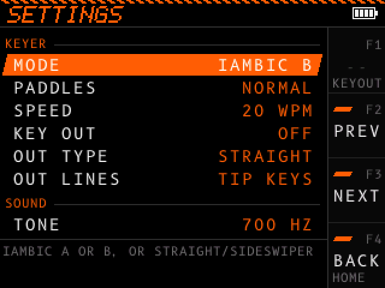
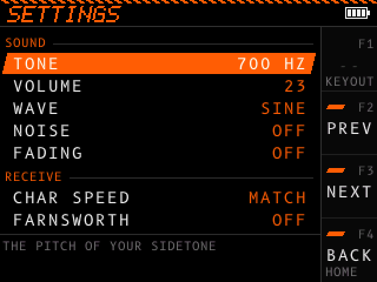
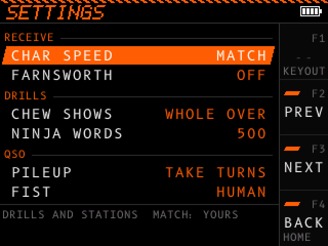
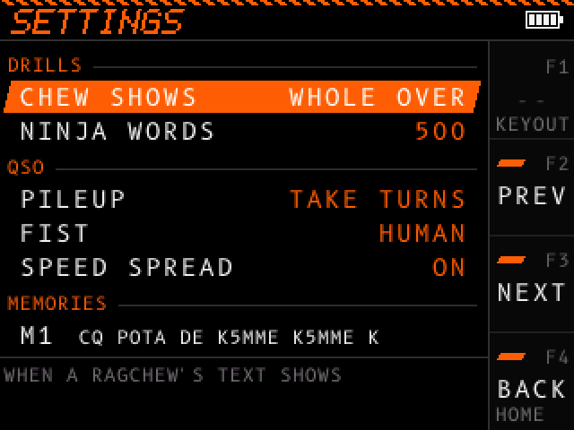
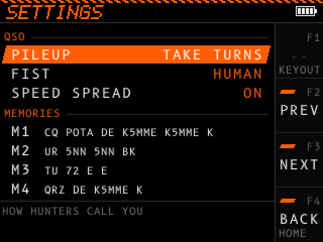
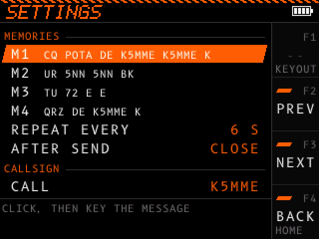
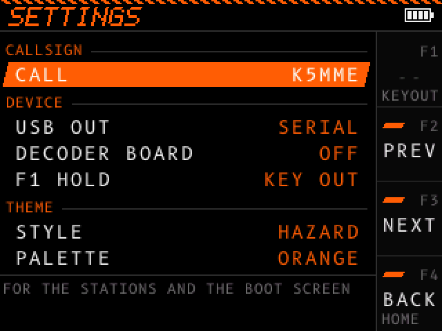
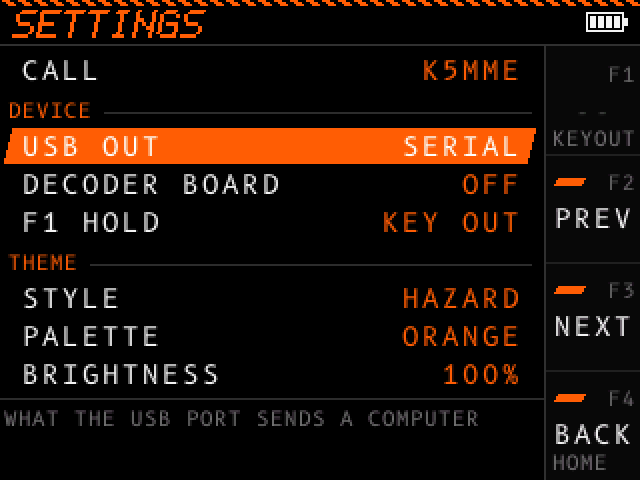
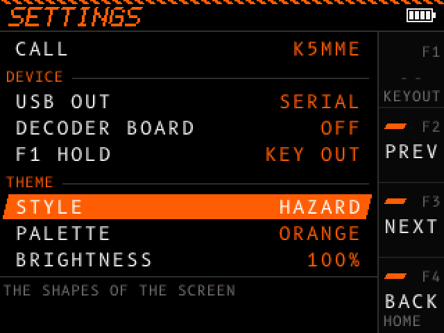

# Settings

All settings are on one screen, in one list with nine sections: KEYER, SOUND, RECEIVE, DRILLS, QSO, MEMORIES, CALLSIGN, DEVICE and THEME. The device saves the settings 2 seconds after your last change.

## Open the settings

| From | Press | Opens at section |
| - | - | - |
| [Menu](menu.md), row SETTINGS | Dial click | KEYER |
| Menu, KEYER, TIMING | F1 (SET) | KEYER |
| KOCH, WORDS, CALLS, HEAD, LETTERS, PROGRESS | F1 (SET) | RECEIVE |
| NINJA, CHEW, QUIZ | F1 (SET) | DRILLS |
| POTA, SOTA, HUNT | F1 (SET) | QSO |
| RADIO | F1 (SET) | DEVICE |
| SYSTEM | F1 (SET) | THEME |

F4 (BACK) leaves the settings and returns to the screen you came from. A drill or a QSO you paused continues. From the SETTINGS row of the menu, F4 (BACK) returns to the menu.

## Controls

| Control | Action |
| - | - |
| F1 hold | Does what F1 HOLD sets, as on every screen. See [Held buttons](controls.md#held-buttons). |
| F2 (PREV) | Selects the first row of the section before. From KEYER, it goes to THEME. |
| F3 (NEXT) | Selects the first row of the next section. From THEME, it goes to KEYER. |
| F4 (BACK) | Leaves the settings. |
| F4 hold (HOME) | Opens the KEYER screen. |
| Dial turn | Selects another row. While you edit, changes the value. |
| Dial click | Starts or ends editing the selected row. While you edit, the value shows as `< value >`. |
| Dial hold | Turns the device off. |
| Key | Nothing more, except while you edit a memory or your callsign. |

Numbers stop at their lowest and highest values. A choice of words goes around: after the last value, the first value comes again.

A line under the list tells you what the selected row sets.

## KEYER

| Row | Values | Default | What it sets |
| - | - | - | - |
| MODE | IAMBIC A, IAMBIC B, STRAIGHT | IAMBIC B | Your key type. See [Keys and jacks](keys.md). |
| PADDLES | NORMAL, REVERSED | NORMAL | NORMAL: dots on the tip contact. REVERSED: dots on the ring contact. STRAIGHT mode ignores this row. |
| SPEED | 5 to 60 WPM | 20 WPM | Your sending speed. |
| KEY OUT | ON, OFF | ON | Whether your key keys the func jack on the KEYER, TIMING and RADIO screens. See [The func jack](keys.md#the-func-jack). |
| OUT TYPE | STRAIGHT, PADDLE | STRAIGHT | STRAIGHT: one line keys, for a radio's straight key input. PADDLE: two lines follow your contacts, for the radio's own keyer. |
| OUT LINES | TIP KEYS, RING KEYS (STRAIGHT); DIT ON TIP, DIT ON RING (PADDLE) | TIP KEYS or DIT ON TIP | Which lines of the func jack key. |

## SOUND

| Row | Values | Default | What it sets |
| - | - | - | - |
| TONE | 300 to 1200 Hz, in steps of 10 Hz | 700 Hz | The pitch of your sidetone. Other stations send at pitches near it. |
| VOLUME | 0 to 44 | 23 | 0 is off. Each step is 1.5 dB on headphones and 1 dB on the speaker. |
| WAVE | SINE, SQUARE | SINE | SINE is a pure tone. SQUARE is a buzzier tone with soft edges. |
| NOISE | OFF, 1 to 10 | OFF | Band noise under the stations you hear. |
| FADING | OFF, 1 to 10 | OFF | How deep the stations you hear fade in and out. |

Noise and fading play in the receive drills, the ragchew, and on the POTA, SOTA and HUNT screens. While a SOUND row is selected, the band noise plays, so you hear the level you set.

## RECEIVE

| Row | Values | Default | What it sets |
| - | - | - | - |
| CHAR SPEED | MATCH, 5 to 40 WPM | MATCH | The speed of each character the device sends you: the drills, the ragchew, and the stations of POTA, SOTA and HUNT. MATCH uses your keyer SPEED. |
| FARNSWORTH | OFF, 5 to 40 WPM | OFF | Longer gaps between characters and words, so the text comes at this slower overall speed. It never goes above CHAR SPEED. |

## DRILLS

| Row | Values | Default | What it sets |
| - | - | - | - |
| CHEW SHOWS | WHOLE OVER, EACH LINE | WHOLE OVER | When the [ragchew](ragchew.md) CHEW shows its text. |
| NINJA WORDS | 100 to 3000, in steps of 100 | 500 | How many words the [NINJA](receive.md#ninja) drill picks from: the ham words first, then the most common English words. |

## QSO

| Row | Values | Default | What it sets |
| - | - | - | - |
| PILEUP | OFF, TAKE TURNS, OVERLAP | TAKE TURNS | How the hunters call when you [activate](activate.md). |
| FIST | HUMAN, CLEAN | HUMAN | HUMAN: each station keys with small timing errors. CLEAN: exact timing. |
| SPEED SPREAD | ON, OFF | ON | ON: each hunter or activator sends up to 5 WPM faster or slower than CHAR SPEED. |

## MEMORIES

| Row | Values |
| - | - |
| M1 to M4 | The message, up to 48 characters. A prosign such as `<AR>` takes 4. |
| REPEAT EVERY | The silence between two sends of a held memory: 2 to 30 seconds. The default is 6 seconds. |
| AFTER SEND | CLOSE closes the MEM row after a send. STAY OPEN keeps the MEM row open, for one QSO after another. |

See [Edit the memories](memories.md#edit-the-memories).

## CALLSIGN

CALL is your callsign. The QSO and hunt screens use it, and the boot screen draws it. The default is N0CALL, a placeholder callsign.

Click the dial on CALL, then key your callsign. Each character you key goes at the end. A callsign holds up to 10 characters: letters, digits and `/`. The device ignores other characters. Click again to end.

| Control while you edit | Action |
| - | - |
| F2 (DEL) | Deletes the last character. |
| F3 hold (CLEAR) | Deletes the whole callsign. |
| Dial click | Ends editing. |
| Key | Adds characters to your callsign. |

## DEVICE

| Row | Values | Default | What it sets |
| - | - | - | - |
| USB OUT | OFF, TEXT, VBAND, SERIAL, RADIO | OFF | What the USB port sends a computer. TEXT types what you key. VBAND sends your keying to VBand. SERIAL is the serial port alone, for a logging program. RADIO types what the decoder board hears, and shows only while DECODER BOARD is ON. See [USB keyboard](usb.md). |
| DECODER BOARD | ON, OFF | OFF | ON: the device powers the decoder board of the Pro model, and the ON AIR list of the menu shows RADIO. RADIO also shows while USB OUT is not OFF, for MIDI in. OFF also changes USB OUT from RADIO to OFF. See [Radio](radio.md). |
| F1 HOLD | KEY OUT, RESUME, MEM ROW, TIMING | KEY OUT | What holding F1 does on every screen. See [Held buttons](controls.md#held-buttons). |

## THEME

| Row | Values | Default | What it sets |
| - | - | - | - |
| STYLE | HAZARD, HUD, BLOCK | HAZARD | The shapes of the screen: the frame, the header, the button labels and the selection. |
| PALETTE | 16 palettes | ORANGE | The colors of the screen and of the boot screen. |
| BRIGHTNESS | 10 % to 100 %, in steps of 10 % | 100 % | The brightness of the screen. |

The palettes are ORANGE, CYAN, AMBER, LIME, DAILY, and the pride flags RAINBOW, TRANS, BI, LESBIAN, PAN, NONBIN, ACE, ARO, FLUID, AGENDER and QUEER. DAILY shows a different flag each time you turn the device on. While you edit STYLE or PALETTE, the whole screen changes as you turn the dial.

The colors that grade your timing are the same in every palette: green, amber and red.
