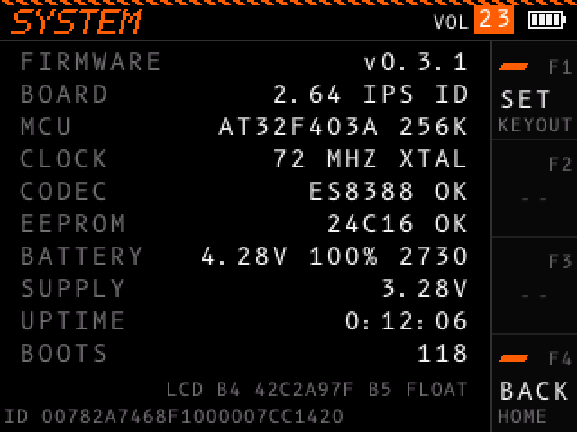

# System

The SYSTEM screen shows the firmware version, the results of the startup checks, and the battery. Open SYSTEM in the [menu](menu.md).

A value in red shows a problem.

## Rows

| Row | Example | What it shows |
| - | - | - |
| FIRMWARE | `v0.2.0` | The PocketCW version. |
| BOARD | `2.64 IPS AUTO` | The board version, the kind of screen, and how the device picked the kind of screen. See below. |
| MCU | `AT32F403A 256K` | The processor and its flash memory size. |
| CLOCK | `72 MHZ XTAL` | The processor speed and its clock source. XTAL is the crystal. HICK, in red, is the less exact internal clock. |
| CODEC | `ES8388 OK` | The audio chip and whether it answered. `NONE FOUND` means no audio chip answered. |
| EEPROM | `24C16 OK` | The memory chip that holds your settings and statistics. With FAIL, the device cannot save. |
| BATTERY | `3.95V 70% 2443` | The battery voltage, the charge in percent, and the raw reading. With USB power, it shows `USB` and the voltage. Red when the battery is low. |
| SUPPLY | `3.29V` | The voltage the processor runs on. |
| UPTIME | `0:12:05` | Hours, minutes and seconds since the device turned on. |
| BOOTS | `57` | How many times PocketCW started. |

`ADC FAIL` in BATTERY and SUPPLY means the device could not read the voltages.

Under the rows, two small lines show what the screen answered on pins B4 and B5 when the device asked for its ID (`FLOAT` means no answer), and the unique ID of the processor. These help when you report a problem.

### How the device picks the kind of screen

| BOARD shows | The kind of screen comes from |
| - | - |
| AUTO | The board version. |
| ID | The ID the screen gave. |
| SET | Your choice: you held F2 when you turned the device on. |
| NOSAVE, in red | You held F2 when you turned the device on, but the device could not save the choice. |

To change the kind of screen, see [Troubleshooting](troubleshooting.md).

## Battery

The battery icon at the right end of the header shows the charge:

| Icon | Meaning |
| - | - |
| Plus sign | USB power. |
| 1 to 4 bars | The charge, in quarters. |
| Red outline, no bars | The battery is low. |

The device learns where full charge reads on your battery. A battery gauge reads a little differently on each board. The device takes a new full point when the battery reads higher than before, after 2 minutes without USB power. The full point stays within 3 % of the design value. The device saves the full point.

When the battery goes below 3.4 V, the status line says `BATTERY LOW: PLUG IN USB`. When the battery stays below 3.2 V, or the supply below 3.1 V, for 10 seconds, the status line says `BATTERY EMPTY: POWERING OFF`. After 2 seconds, the device saves everything and turns off.

## Controls

| Control | Action |
| - | - |
| F1 (SET) | Opens the settings at the THEME section. F4 (BACK) there returns to this screen. |
| F2, F3 | Nothing. |
| F4 (BACK) | Opens the [menu](menu.md), with SYSTEM selected. |
| Dial turn | Changes the focused header value. See [Header values](controls.md#header-values). |
| Dial click | Moves the focus to the next header value. |
| Dial hold | Turns the device off. |
| Key | Nothing more. |
