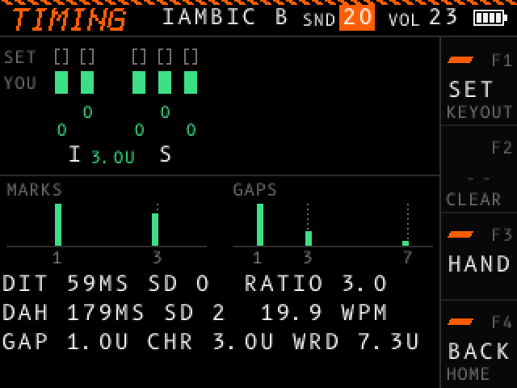
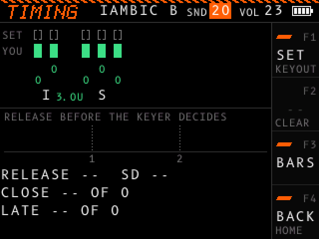

# Timing

The TIMING screen gives a close look at your keying. Open it with F3 (TMNG) on the KEYER screen, or from the [menu](menu.md). The header shows TIMING, the keyer mode, and the SND and VOL values.

The screen measures every mark and gap against the dot length the decoder uses: the dot length of your set speed in the iambic modes, or of the speed you actually send in STRAIGHT mode. A unit is that dot length. The screen grades each mark and gap as good, off or bad. See [Timing grades](keyer.md#timing-grades).

## What the screen shows

### Zoomed tape

The tape draws time from left to right, 8 pixels per dot length.

- The SET row shows brackets around the ideal length of each mark.
- The YOU row shows each mark you sent, in the color and shape of its grade. A good mark is solid, an off mark has a stripe through it, and a bad mark is an outline.
- Over each mark, a number shows its error in percent: `+10` is 10 % long, `-10` is 10 % short.
- Under the marks, each decoded character shows, and each gap between characters or words shows its length in units.
- A gap inside a character that is off or bad gets an underline in its grade.

Under the tape, F3 switches between two views: BARS, and HAND.

### BARS view

| Histogram | Range | Dotted lines at |
| - | - | - |
| MARKS | 0 to 4 units | 1 (dot) and 3 (dash) |
| GAPS | 0 to 8 units | 1 (inside a character), 3 (between characters) and 7 (between words) |

Each bar counts the marks or gaps of that length, in the color of the grade a mark or gap of that length gets.

| Line | What it shows |
| - | - |
| DIT | Average dot length and its standard deviation (SD) in milliseconds, then RATIO: average dash over average dot. The ideal ratio is 3. |
| DAH | Average dash length and its standard deviation in milliseconds, then the speed your timing works out to. |
| GAP, CHR, WRD | Average gap inside characters, between characters and between words, in units. |

### HAND view

The HAND view shows what your paddle or key does, not what the keyer sends. It shows the statistics for the MODE in use.

In IAMBIC A and IAMBIC B, the keyer decides one unit after each element whether to send another. A paddle closed at that moment, or pressed during the element, sends one.

| Item | What it shows |
| - | - |
| RELEASE BEFORE THE KEYER DECIDES | A histogram from 0 to 3 units: at the end of each character, how long before the keyer's decision you let go. A bar under half a unit is red: a little later, and the keyer would have sent one more element. |
| RELEASE | The average and standard deviation of that time, in units. |
| CLOSE | The percent of characters you let go less than half a unit before the decision, and how many characters it counts. |
| LATE | The percent of gaps inside characters you started after the keyer's decision, how many gaps it counts, and how late they came on average, in units. A late press makes a gap longer than one unit. LATE counts only the gaps that still read as inside a character; a press late enough to split the character shows as a short gap between characters in the BARS view. |

In STRAIGHT, for a straight key or a sideswiper:

| Line | What it shows |
| - | - |
| TIP, RING | For each contact, the average length and standard deviation of the dots and dashes it keyed, in milliseconds. A mark counts for the contact that closed first. A straight key uses only the tip. |
| WEIGHT | Each dot over the gap after it inside a character, on average, with its standard deviation. 1.00 is even; more is heavy, less is light. |
| RATIO | For each contact, its average dash over its average dot. 3.0 is standard. |
| OVERLAP | The percent of marks during which the other contact closed too, and how many marks it counts. On a sideswiper, the second contact holds the key down, so the mark runs long. |

Keying that `SEND` sends over USB counts in BARS, but not in HAND.

The statistics collect your keying on every screen since the device was turned on, or since you last held F2 (CLEAR). The KEYER screen shows the BARS statistics.

## Controls

| Control | Action |
| - | - |
| F1 (SET) | Opens the settings at the KEYER section. |
| F2 hold (CLEAR) | Clears the statistics and the tape. |
| F3 (HAND or BARS) | Switches the view under the tape. |
| F4 (BACK) | Opens the [menu](menu.md), with TIMING selected. |
| Dial turn | Changes the focused header value. See [Header values](controls.md#header-values). |
| Dial click | Moves the focus to the next header value. |
| Dial hold | Turns the device off. |
| Key | Draws on the tape and adds to the statistics. |
